 

<b>
<a href="https://adriane-dev.vercel.app/home">Portfolio</a>
&nbsp;&nbsp;•&nbsp;&nbsp;
<a href="https://www.linkedin.com/in/adriane-frane-9b80b8285/">LinkedIn</a>
&nbsp;&nbsp;•&nbsp;&nbsp;
<a href="https://github.com/Adenggggg">GitHub</a>
</b>

  

 

